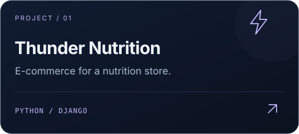
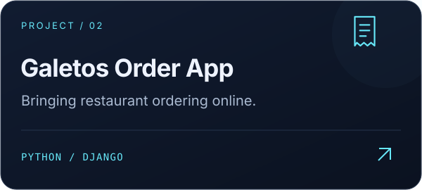
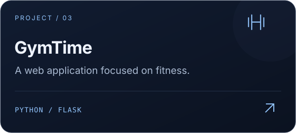
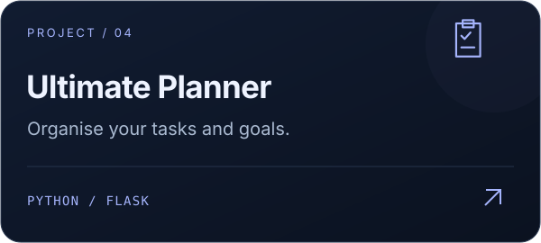
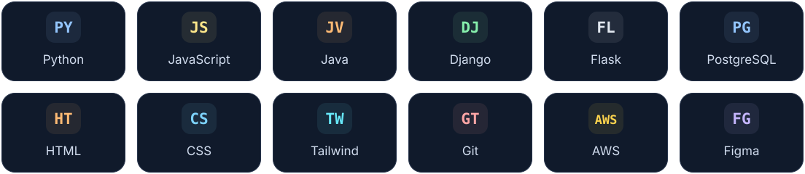

<picture>
  <source media="(max-width: 600px)" srcset="./hero-mobile.svg" />
  
</picture>

 

  
  
  

<h2 align="center">Software with a practical purpose.</h2>

  I'm a Dublin-based developer transitioning from healthcare into technology. 
  I build web applications with Python, Django, Flask and JavaScript, 
  and I'm expanding my skills in artificial intelligence and machine learning.

  🎓 <strong>Currently pursuing a Higher Diploma in Science in Computing</strong> 
  <strong>Artificial Intelligence &amp; Machine Learning</strong> 
  National College of Ireland

  Open to entry-level opportunities, work experience and collaborative projects.

<h2 align="center">Selected work</h2>

<!-- The first three cards open filtered repository lists.
Replace their hrefs with exact repository URLs for direct links. -->

  
  
  
  

  <a href="https://github.com/Cesargarciajr?tab=repositories"><strong>Explore all repositories ↗</strong></a>

<h2 align="center">My toolkit</h2>

<picture>
  <source media="(max-width: 600px)" srcset="./stack-mobile.svg" />
  
</picture>

  Also working with SQL, SQLite, SQLAlchemy, Bootstrap, GitHub, Cloudinary and Visual Paradigm.

  
<strong>🎓 Education &amp; milestones</strong>

 

- **Higher Diploma in Science in Computing — AI & Machine Learning**  
  National College of Ireland · In progress
- **Certificate in Science in Computing**  
  National College of Ireland · First Class Honours · **93.4%**
- **Diploma in Full Stack Software Development**  
  Code Institute · Completed
- **CS50x: Introduction to Computer Science**  
  Harvard's CS50 · Completed

  
<strong>🔎 What I'm focusing on</strong>

 

- Object-oriented software engineering and UML modelling.
- Responsive web design and client-side development.
- Building a foundation for further study in AI and machine learning.
- Turning practical problems into useful, maintainable applications.

 

  <strong>Have a project, opportunity or idea to share?</strong>  
  <a href="mailto:cesargarcia.elder@gmail.com">Let's connect ↗</a>

